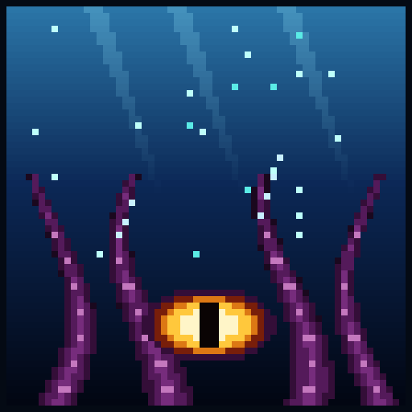
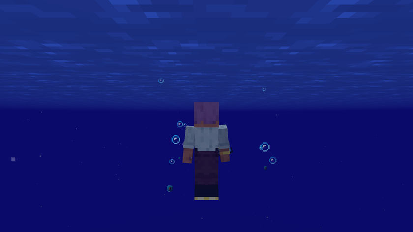

# Bottomless (Sans Fond)

## English

Bottomless is a Minecraft mod that adds the Abyss, a dimension under the deep oceans, all water from Y 0 down to Y -512. You dive in with a syphon, survive the pressure, trade with drowned villages, explore sunken citadels and hunt the giant Kraken.

- [The guide](en/guide.md): installing the mod, getting in and out, pressure, playing step by step
- [The world](en/world.md): the three layers, villages, citadels, vents, ores
- [Creatures](en/creatures.md): every creature and both bosses, their numbers and their loot
- [Items and mechanics](en/items.md): equipment, enchantments, Kraken conduit, currents, crops, trades, advancements
- [Recipes](en/recipes.md): every recipe in the mod

This wiki describes version 1.7.0. Nobody has played a full survival game with it yet, so balance values may change. The numbers come from the mod's code.

## Français

Sans Fond est un mod Minecraft qui ajoute les Abysses, une dimension sous les océans profonds, tout en eau de Y 0 à Y -512. On y plonge avec un syphon, on survit à la pression, on commerce avec des villages noyés, on explore des citadelles englouties et on chasse le Kraken géant.

- [Le guide](fr/guide.md) : installer le mod, entrer et sortir, la pression, jouer étape par étape
- [Le monde](fr/monde.md) : les trois couches, les villages, les citadelles, les cheminées, les minerais
- [Les créatures](fr/creatures.md) : chaque créature et les deux boss, leurs chiffres et leur butin
- [Objets et mécaniques](fr/objets.md) : équipement, enchantements, conduit du kraken, courants, cultures, échanges, progrès
- [Les recettes](fr/recettes.md) : toutes les recettes du mod

Ce wiki décrit la version 1.7.0. Personne n'a encore joué une partie complète en survie : l'équilibrage peut changer. Les chiffres viennent du code du mod.

