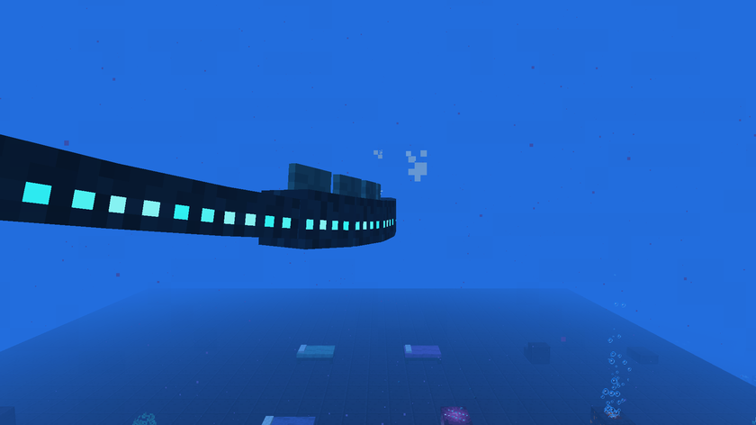
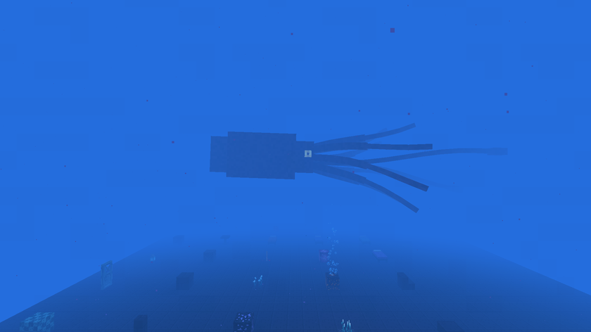

# Creatures

[Back to the wiki](../README.md) · [Version française](../fr/creatures.md)

| Creature | Health | Damage | Behaviour | Drops |
|---|---|---|---|---|
| Anglerfish | 12 | 3 | Swims everywhere, defends villagers | Abyss lantern (30 %) |
| Sea dragon | 16 | 4 | Swims in the midnight zone and the trench, defends villagers | Abyss lantern (30 %) |
| Drowned villager | 20 | — | Peaceful, stays around its village, trades | — |
| Corrupted drowned villager | 24 (+25 % midnight, +50 % trench) | 4 (same bonus) | Hostile, spawns in the dark, attacks players and villagers outside villages | 0 to 2 rotten flesh, prismarine shard (25 %) |
| Leviathan | 120, armor 6 | 12 | Boss of the citadels | Leviathan fang |
| Giant Kraken | 600, armor 10 | 16 | Boss of the trench | Kraken heart, 4 to 12 Kraken tentacles |

## Leviathan

It guards its citadel and stays within 16 blocks of it. It bites at close range, roars (16 blocks) and crushes: players within 12 blocks lose 150 air and get Slowness III and **Crushed** for 6 seconds, which cancels the abyss helmet and the Kraken conduit. It calls reinforcements at two thirds and one third of its health.

## Giant Kraken

Very rare, only below Y -370 in the trench, and never within 256 blocks of another Kraken, even one in an unloaded chunk. It never spawns in or near a village. It slams the area around it (11 blocks), grabs a player up to 26 blocks away and pulls them to its mouth, and spits ink that blinds. It does not despawn.

## Elder Guardian

Vanilla, but it now always drops a guardian eye, needed for the syphon.
