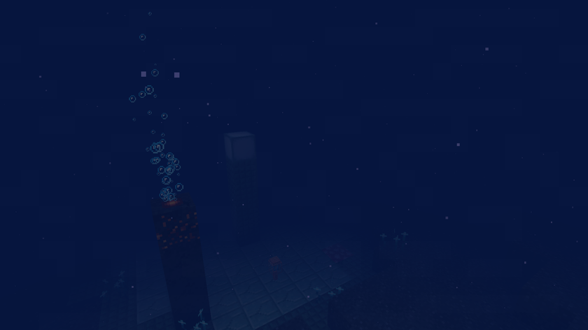

# Guide

[Back to the wiki](../README.md) · [Version française](../fr/guide.md)

## Installation

Minecraft 1.21.1, NeoForge 21.1.265 or newer, Java 21. Install it on the client and on the server. No other mod is needed.

## Getting in

1. Kill an Elder Guardian (ocean monument): it always drops a **guardian eye**.
2. Craft a **syphon**: 6 nautilus shells, 2 hearts of the sea and the guardian eye. It has 5 uses.
3. Swim in a deep ocean, in the water, and use it. It pulls you down for up to 12 seconds; as soon as you touch the seabed, or go below Y -30, you are sent into the Abyss at the same X and Z, in open water near Y -300. It does not work in the Abyss.

## Getting out

Swim up to the surface of the Abyss (above Y -2.5): you come back exactly where you used the syphon. If you die in the Abyss, you respawn at your normal spawn point.

## Pressure

Without protection, your air runs out twice as fast and you get Slowness I. In the abyssal trench (below Y -350) it runs out three times as fast and Slowness goes up to level II.
These protect you completely: the **abyss helmet**, the **abyssite helmet**, and standing in the water within 16 blocks of a **Kraken conduit**. The Leviathan's Crushed effect cancels all of them while it lasts.
Hydrothermal vents give air back when you swim above them.

## Step by step

1. Syphon, then the **abyss helmet** (turtle shell, prismarine, long water breathing potions).
2. Find a **drowned village** on the floor of the trench (`/locate structure bottomless:abyss_village`) and trade with prismarine shards and crystals.
3. Find a **sunken citadel** (`/locate structure bottomless:abyss_citadel`), defeat its Leviathan and loot the abyssite, the smithing template and the books.
4. Mine **abyssite ore** deep in the trench with a netherite pickaxe, upgrade your netherite armor.
5. Hunt the **giant Kraken** at the bottom of the trench. Its heart makes the **Kraken trident** or a **Kraken conduit**; its tentacles make **ocean currents**.

The advancement tab "Bottomless" follows the same path, from the syphon to the Kraken trident.
