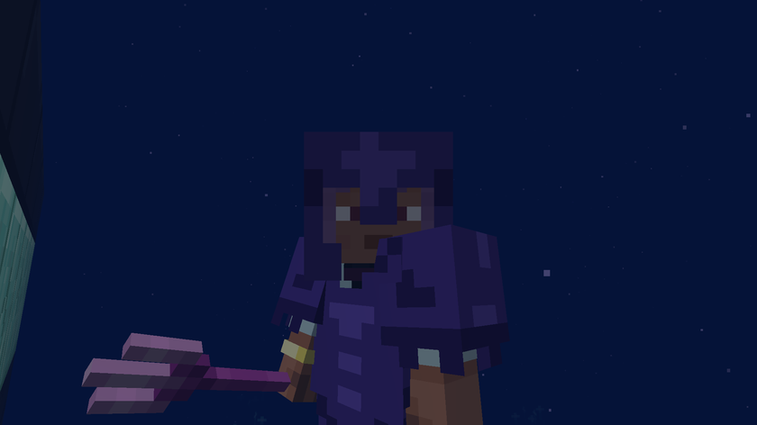
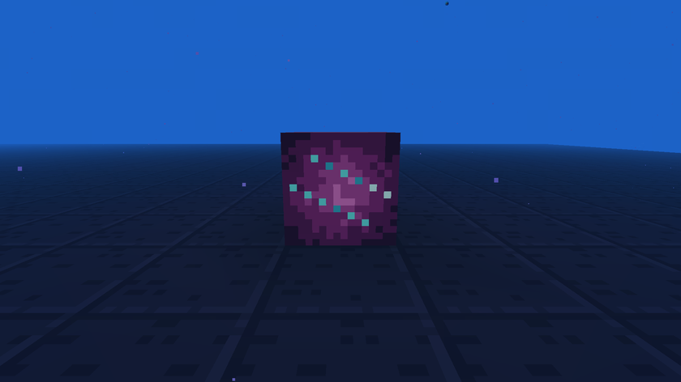
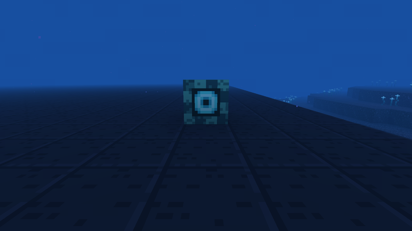

# Items and mechanics

[Back to the wiki](../README.md) · [Version française](../fr/objets.md)

## Equipment

| Item | Effect |
|---|---|
| Syphon | 5 uses, takes you into the Abyss from a deep ocean |
| Abyss helmet | Iron stats, removes pressure in the Abyss |
| Abyssite armor | Netherite armor upgraded with an abyssite ingot: the helmet removes pressure, each piece gives +15 % swim speed |
| Kraken trident | 12 melee damage, +4 when thrown, always comes back, lights up around you, +60 % swim speed in hand |
| Leviathan blade | 10 damage, slows the target for 3 seconds, +4 damage against a target in water |

## Enchantments

Sold by the drowned lighthouse keeper and found in citadels.

- **Ballast** (boots, I to III): sink faster, and jumping pushes you back up faster.
- **Luminescence** (helmet): lights up around you, like the Kraken trident.

## Kraken conduit

Made from a Kraken heart. Placed against water, it gives **Pressure Ward** every 2 seconds to every player in the water within 16 blocks. Pressure Ward protects like the abyss helmet. It uses the same heart as the trident: one Kraken, one choice.

## Ocean currents

Made from Kraken tentacles (4 per craft). A current pushes whatever is in the water in front of it, in the direction you were looking when you placed it, over up to 8 blocks of water, up to 0.5 block per tick. The stream stops at the first block that is not water.

## Crops and food

Glowing seaweed, pearl potatoes and coral fruit grow underwater on abyss sand, in the village fields. Cook the seaweed and the potatoes; the abyss stew uses all three.

## Trades

Villagers pay in prismarine shards and crystals and restock 12,000 ticks after their last restock.

| Profession | Sells |
|---|---|
| Mason | abyss sand, abyss rock, polished rock, bricks, a table, a bed |
| Farmer | seaweed spores, pearl potatoes, coral fruit, abyss stew; buys glowing seaweed |
| Fisherman | cooked seaweed, abyss lantern, nautilus shell; buys abyss lanterns |
| Lighthouse keeper | abyss torches, coral lamps, door, trapdoors, Ballast and Luminescence books |

## Building blocks

Abyss sand, abyss rock, polished abyss rock and bricks with slabs, stairs and a wall, copper bars, watertight abyss doors and trapdoors, abyss tables, coral lamps, abyss lanterns, decorative abyss beds in four colors (you cannot sleep in them).

## Advancements

Bottomless → The Big Dive → Under Pressure → Deep Metal → Citadel Keeper; Under Pressure → Heart of Darkness → Master of the Abyss.
