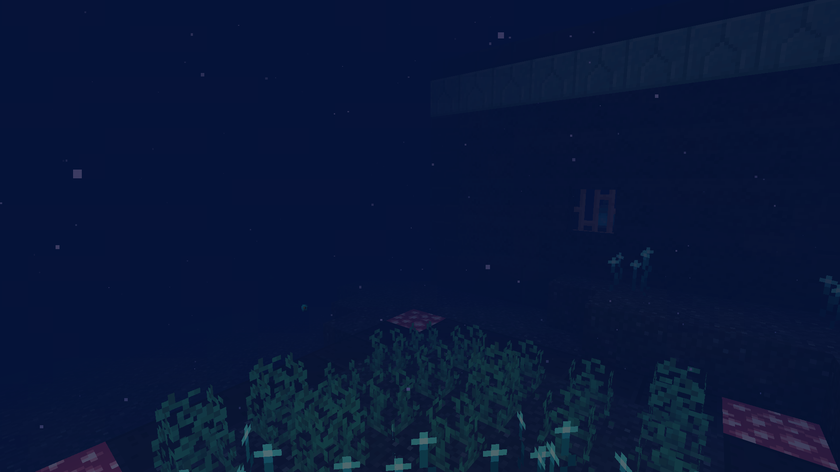

# The world

[Back to the wiki](../README.md) · [Version française](../fr/monde.md)

The Abyss goes from Y -512 to Y 15, with water up to Y -1. There is no sky and the light fades with depth: the fog closes in to about ten blocks at the bottom.

| Layer | Depth | Lives there |
|---|---|---|
| Twilight zone | above Y -150 | cod, anglerfish, glow squid, corrupted villagers |
| Midnight zone | Y -150 to -350 | anglerfish, sea dragons, glow squid, corrupted villagers (+25 % health and damage) |
| Abyssal trench | below Y -350 | sea dragons, corrupted villagers (+50 %), the giant Kraken, villages, citadels, abyssite |

## Drowned villages

On the floor of the trench. Houses, lanterns, crop fields, and drowned villagers with four professions. Anglerfish and sea dragons live around them and defend them. No monster spawns in a village or within 16 blocks of its bounds, at any height, and corrupted villagers do not target villagers that are inside their village.

## Sunken citadels

Guarded by a Leviathan, two guardians and four corrupted villagers that stay around it. Their chests hold abyssite fragments and ingots, the abyssite upgrade smithing template, Ballast and Luminescence books, spores and syphons.

## Hydrothermal vents

On the floor of the midnight zone and the trench, about one every three chunks, on top of 1 to 3 abyss rock blocks. Every 10 ticks a vent gives 40 air to whatever swims in the 8 blocks above it. Standing on it burns (like magma; sneaking avoids it). It can be mined with a pickaxe and placed again.

## Abyssite ore

Below Y -400, in abyss rock. It only drops with a netherite pickaxe.

## Abyss torches

Light that only stays lit in the Abyss: anywhere else it fizzles out and breaks.
