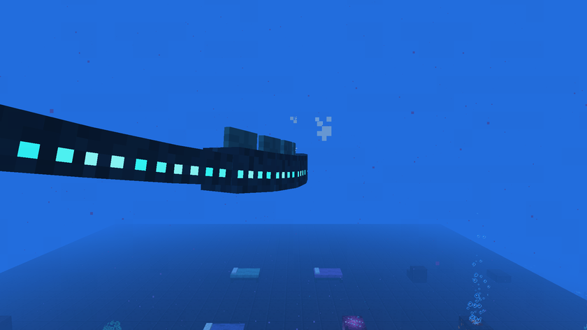
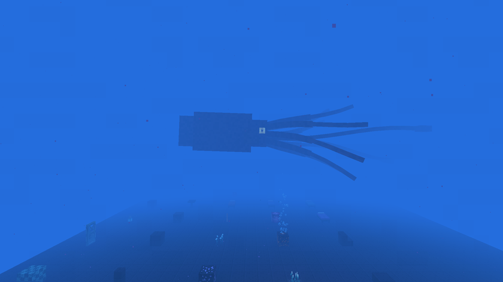

# Les créatures

[Retour au wiki](../README.md) · [English version](../en/creatures.md)

| Créature | Vie | Dégâts | Comportement | Butin |
|---|---|---|---|---|
| Poisson-pêcheur | 12 | 3 | Nage partout, défend les villageois | Lanterne des abysses (30 %) |
| Dragon des mers | 16 | 4 | Nage dans la zone de minuit et la fosse, défend les villageois | Lanterne des abysses (30 %) |
| Villageois noyé | 20 | — | Pacifique, reste autour de son village, commerce | — |
| Villageois noyé corrompu | 24 (+25 % minuit, +50 % fosse) | 4 (même bonus) | Hostile, naît dans le noir, attaque les joueurs et les villageois hors des villages | 0 à 2 chairs putréfiées, éclat de prismarine (25 %) |
| Léviathan | 120, armure 6 | 12 | Boss des citadelles | Croc du Léviathan |
| Kraken géant | 600, armure 10 | 16 | Boss de la fosse | Cœur de kraken, 4 à 12 tentacules |

## Léviathan

Il garde sa citadelle et reste à moins de 16 blocs. Il mord de près, rugit (16 blocs) et écrase : les joueurs à moins de 12 blocs perdent 150 d'air et prennent Lenteur III et **Écrasement** pendant 6 secondes, qui annule le casque des abysses et le conduit du kraken. Il appelle des renforts aux deux tiers et au tiers de sa vie.

## Kraken géant

Très rare, seulement sous Y -370 dans la fosse, et jamais à moins de 256 blocs d'un autre Kraken, même dans un chunk déchargé. Il n'apparaît jamais dans un village ni près. Il frappe tout autour de lui (11 blocs), saisit un joueur jusqu'à 26 blocs pour le tirer vers sa gueule, et crache une encre qui aveugle. Il ne disparaît pas.

## Gardien ancien

Vanilla, mais il lâche maintenant toujours un œil du gardien, nécessaire au syphon.
