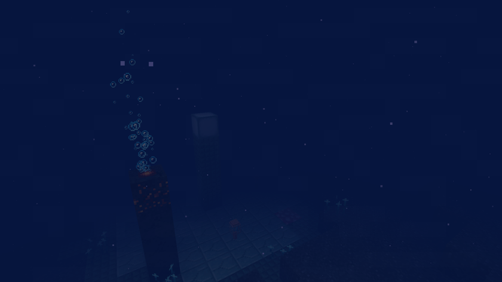

# Guide

[Retour au wiki](../README.md) · [English version](../en/guide.md)

## Installation

Minecraft 1.21.1, NeoForge 21.1.265 ou plus récent, Java 21. À installer sur le client et sur le serveur. Aucun autre mod n'est nécessaire.

## Entrer

1. Tuez un Gardien ancien (monument océanique) : il lâche toujours un **œil du gardien**.
2. Fabriquez un **syphon** : 6 coquilles de nautile, 2 cœurs de la mer et l'œil du gardien. Il sert 5 fois.
3. Nagez dans un océan profond, dans l'eau, et utilisez-le. Il vous aspire pendant 12 secondes au plus ; dès que vous touchez le fond, ou passez sous Y -30, vous êtes envoyé dans les Abysses aux mêmes X et Z, en eau libre vers Y -300. Il ne marche pas dans les Abysses.

## Sortir

Remontez à la surface des Abysses (au-dessus de Y -2,5) : vous revenez exactement là où vous avez utilisé le syphon. Si vous mourez dans les Abysses, vous réapparaissez à votre point habituel.

## La pression

Sans protection, l'air s'épuise deux fois plus vite et vous avez Lenteur I. Dans la fosse abyssale (sous Y -350), trois fois plus vite, et la Lenteur passe au niveau II.
Ce qui protège entièrement : le **casque des abysses**, le **casque en abyssite**, et être dans l'eau à moins de 16 blocs d'un **conduit du kraken**. L'Écrasement du Léviathan annule tout cela tant qu'il dure.
Les cheminées hydrothermales rendent de l'air quand on nage au-dessus.

## Étape par étape

1. Le syphon, puis le **casque des abysses** (carapace de tortue, prismarine, potions de respiration longues).
2. Trouvez un **village noyé** sur le fond de la fosse (`/locate structure bottomless:abyss_village`) et commercez avec des éclats et des cristaux de prismarine.
3. Trouvez une **citadelle engloutie** (`/locate structure bottomless:abyss_citadel`), battez son Léviathan et pillez l'abyssite, le modèle de forge et les livres.
4. Minez le **minerai d'abyssite** au fond de la fosse avec une pioche en netherite, améliorez votre armure en netherite.
5. Chassez le **Kraken géant** au fond de la fosse. Son cœur donne le **trident du kraken** ou un **conduit du kraken** ; ses tentacules donnent les **courants marins**.

L'onglet de progrès « Sans Fond » suit le même chemin, du syphon au trident du kraken.
