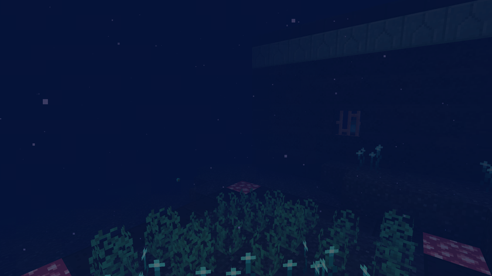

# Le monde

[Retour au wiki](../README.md) · [English version](../en/world.md)

Les Abysses vont de Y -512 à Y 15, avec de l'eau jusqu'à Y -1. Il n'y a pas de ciel et la lumière baisse avec la profondeur : au fond, le brouillard ne laisse voir qu'une dizaine de blocs.

| Couche | Profondeur | Y vivent |
|---|---|---|
| Zone crépusculaire | au-dessus de Y -150 | morues, poissons-pêcheurs, calmars luisants, villageois corrompus |
| Zone de minuit | Y -150 à -350 | poissons-pêcheurs, dragons des mers, calmars luisants, villageois corrompus (+25 % de vie et de dégâts) |
| Fosse abyssale | sous Y -350 | dragons des mers, villageois corrompus (+50 %), le Kraken géant, villages, citadelles, abyssite |

## Villages noyés

Sur le fond de la fosse. Maisons, lanternes, champs, et villageois noyés de quatre métiers. Des poissons-pêcheurs et des dragons des mers vivent autour et les défendent. Aucun monstre n'apparaît dans un village ni à moins de 16 blocs de ses limites, à toute hauteur, et les villageois corrompus ne visent pas les villageois qui sont dans leur village.

## Citadelles englouties

Gardées par un Léviathan, deux gardiens et quatre villageois corrompus qui restent autour. Leurs coffres contiennent des fragments et lingots d'abyssite, le modèle de forge d'amélioration abyssale, des livres Lest et Luminescence, des spores et des syphons.

## Cheminées hydrothermales

Sur le fond de la zone de minuit et de la fosse, environ une pour trois chunks, au sommet de 1 à 3 blocs de roche des abysses. Toutes les 10 ticks, une cheminée rend 40 d'air à ce qui nage dans les 8 blocs au-dessus. Marcher dessus brûle (comme le magma ; en s'accroupissant, non). Elle se mine à la pioche et se repose.

## Minerai d'abyssite

Sous Y -400, dans la roche des abysses. Il ne se récolte qu'à la pioche en netherite.

## Torches des abysses

Une lumière qui ne reste allumée que dans les Abysses : ailleurs, elle grésille et se casse.
