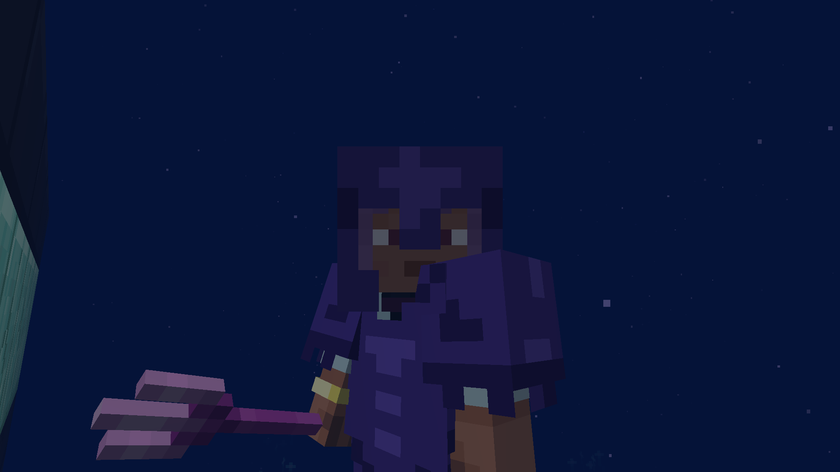
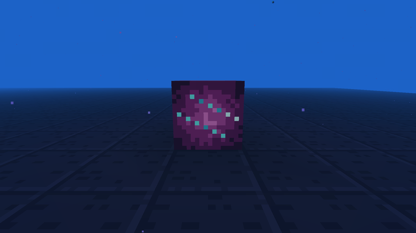
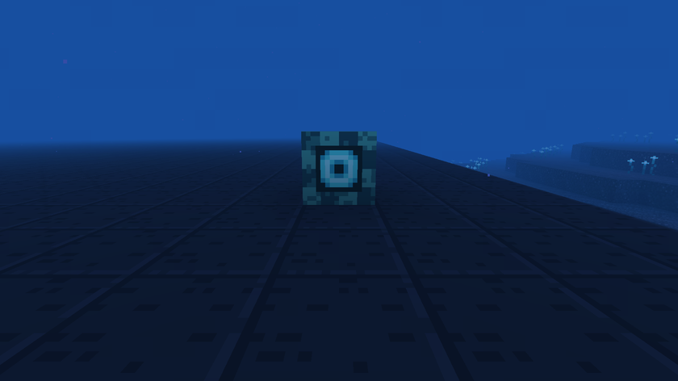

# Objets et mécaniques

[Retour au wiki](../README.md) · [English version](../en/items.md)

## Équipement

| Objet | Effet |
|---|---|
| Syphon | 5 usages, emmène dans les Abysses depuis un océan profond |
| Casque des abysses | Statistiques du fer, supprime la pression dans les Abysses |
| Armure en abyssite | Armure en netherite améliorée d'un lingot d'abyssite : le casque supprime la pression, chaque pièce donne +15 % de vitesse de nage |
| Trident du kraken | 12 dégâts au corps à corps, +4 au lancer, revient toujours, éclaire autour de vous, +60 % de vitesse de nage en main |
| Lame du Léviathan | 10 dégâts, ralentit la cible 3 secondes, +4 dégâts contre une cible dans l'eau |

## Enchantements

Vendus par le gardien du phare noyé et trouvés dans les citadelles.

- **Lest** (bottes, I à III) : on coule plus vite, et sauter fait remonter plus vite.
- **Luminescence** (casque) : éclaire autour de vous, comme le trident du kraken.

## Conduit du kraken

Fait d'un cœur de kraken. Posé contre l'eau, il donne **Protection contre la pression** toutes les 2 secondes à tous les joueurs dans l'eau à moins de 16 blocs. Cette protection vaut le casque des abysses. Il prend le même cœur que le trident : un Kraken, un choix.

## Courants marins

Faits de tentacules de kraken (4 par fabrication). Un courant pousse ce qui est dans l'eau devant lui, dans la direction où vous regardiez en le posant, sur 8 blocs d'eau au plus, jusqu'à 0,5 bloc par tick. Le courant s'arrête au premier bloc qui n'est pas de l'eau.

## Cultures et nourriture

L'algue lumineuse, la perle-patate et le corail-fruit poussent sous l'eau sur du sable des abysses, dans les champs des villages. L'algue et la patate se cuisent ; le ragoût des abysses utilise les trois.

## Échanges

Les villageois paient et se font payer en éclats et cristaux de prismarine, et se réapprovisionnent 12 000 ticks après leur dernier réapprovisionnement.

| Métier | Vend |
|---|---|
| Maçon | sable et roche des abysses, roche polie, briques, une table, un lit |
| Fermier | spores d'algue, perles-patates, corail-fruit, ragoût des abysses ; achète l'algue lumineuse |
| Pêcheur | algue grillée, lanterne des abysses, coquille de nautile ; achète des lanternes |
| Gardien du phare | torches des abysses, lampes de corail, porte, trappes, livres Lest et Luminescence |

## Blocs de construction

Sable et roche des abysses, roche polie et briques avec dalles, escaliers et muret, barreaux en cuivre, portes et trappes étanches, tables, lampes de corail, lanternes des abysses, lits décoratifs de quatre couleurs (on ne peut pas y dormir).

## Progrès

Sans Fond → Le grand plongeon → Sous pression → Métal des profondeurs → Gardien de la citadelle ; Sous pression → Le cœur des ténèbres → Maître des abysses.
